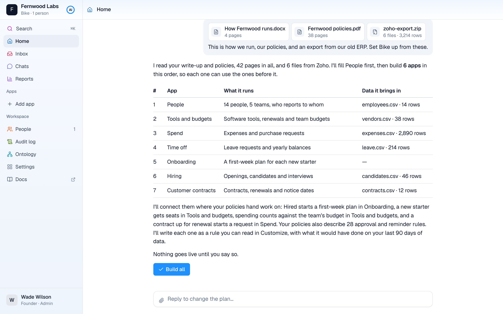
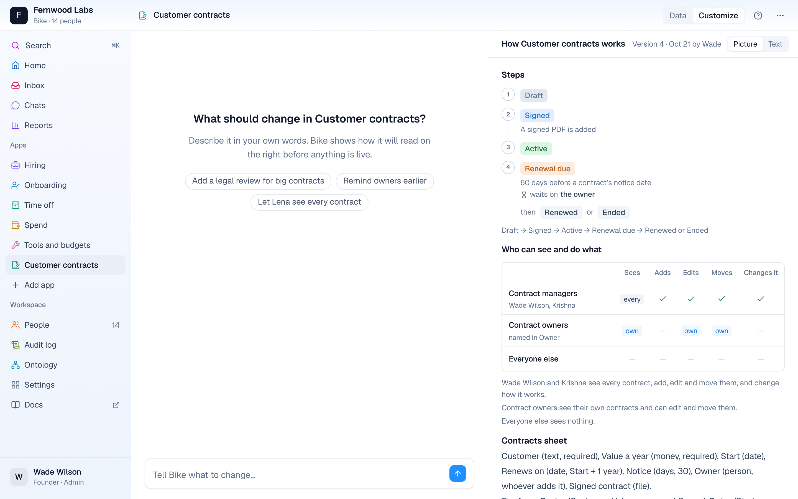
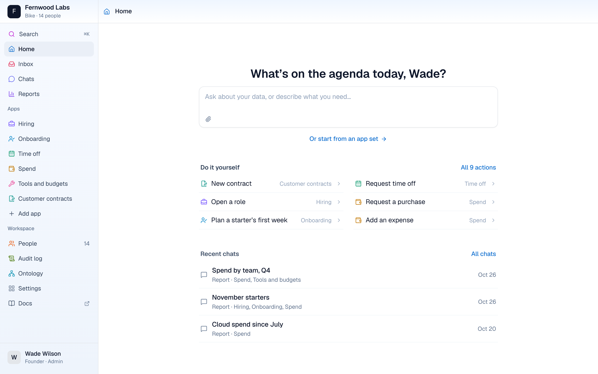
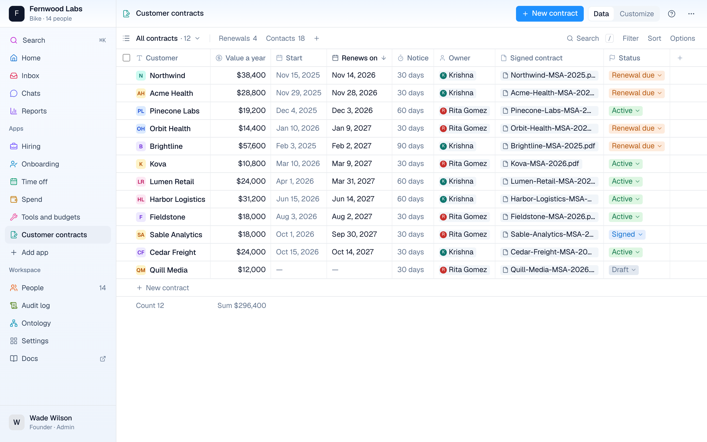
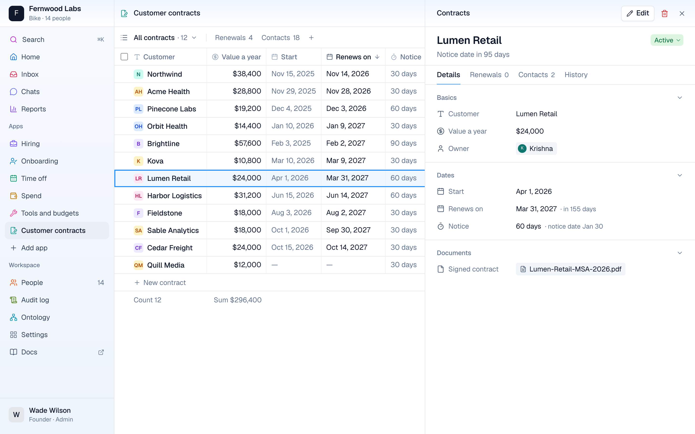

# Bike

**Bike** is an ERP that AI builds and changes from plain words, while people work in it by point and click.
Upload how your company runs (policies, spreadsheets, forms) and Bike proposes your apps, who sees what, and the
rules between them; after that, any admin can change an app by describing the change. The AI only ever proposes: a
deterministic kernel decides, applies and records every change, so the AI never touches your data.



- **Built from your documents, not from templates.** Bike reads how you already work and drafts a set of connected
  apps (contracts, hiring, spend, time off) with their steps, roles and rules, in under an hour.
- **Change an app by describing the change.** An admin types the change beside the app ("contracts over $50k need
  legal review") and sees it as a picture and as plain text. Bike also lists what else it touches. Nothing is live
  until the admin clicks Apply.
- **Rules are tested on your past before they go live.** A new rule replays read-only over the last 90 days of
  real rows, so you see what it would have done. A rule that would set off a loop is refused when it's saved.
- **The numbers never come from the model.** When you ask a question, the AI writes a report query; the kernel runs
  it with the asker's own access. Every figure is computed, never generated, and can't show anything the asker
  isn't allowed to see.
- **Data is never guessed.** A change that would move or convert data is previewed with the rows it changes and the
  rows it can't map. If any value can't be mapped, the change is refused, and old values are kept so the change can
  be checked.
- **AI for building, not for every click.** Everyday work is plain forms, tables and approvals with almost no AI
  calls, so it stays fast, cheap and predictable.

This repository is the Bike a company runs on its own server, for one company at one address. BikeApp also runs it as a hosted service at [bikeapp.si](https://bikeapp.si).

## How it works

- **The kernel is the only writer.** Screens, imports, rules and the AI's plans all call it. Every write is one
  database transaction: check it against the app, check the person's access (their role, and whether they see all
  rows, their own or their team's), apply it and recompute totals, run the rules it sets off (at most three levels
  deep), and write it to the Audit log. The same input always gives the same result.
- **The AI proposes, the kernel runs.** The model returns plans, rules, report queries and proposals as JSON. The
  kernel checks every name, type and person in them against the apps before anyone sees them, and nothing is saved
  until a person confirms. The model never writes to the database, runs a rule, computes a number or does a
  person's task. Uploaded documents are read as data, never as instructions.
- **Apps are versioned files.** An app is a file of sheets, columns, steps, roles and rules. Rows store column ids
  and the app version they were written under, so changing an app makes a new version, not a database migration.
- **Access lives in the kernel and the database.** Every row carries its company's id under Postgres row-level
  security, and what the AI is given, and what a report can show, is limited to what the asking person may see.
- **The Audit log is append-only**, and admins see it exactly as recorded.

## The mission

Every company runs on software that someone else designed for some other company. People bend their work to fit
it, pay consultants to change it, and keep the rest in spreadsheets.

Bike's mission is to end that: **the all-in-one ERP for any kind of business, of any size, in any industry**, built
from how the company already works, changed by saying what should change, and run by everyone with point and click.
Every number computed, never guessed. Every change on record. The AI proposes; the company decides.

## The plan

We get there in five stages. Each one stands on the one before it.

**Stage 1 · Build a company's apps from how it works.** ✅ *Done.*
Upload your write-up, policies and old exports, or describe the work, and Bike plans and builds the connected apps
in an afternoon: contracts, hiring, onboarding, purchasing and spend, time off, budgets, projects. Admins change any
app in plain words. Rules are tested on your last 90 days before they go live. Reports are asked in words and
computed by the kernel. Everyone works in forms, tables, boards, an Inbox and Waiting on me.

**Stage 2 · Let any company run it, anywhere.** ✅ *Done (0.6).*
Bike is open source. One `docker compose up` on your own server, x86-64 or ARM; your own AI key or none at all;
nightly backups; signed updates you can roll back. Or use the hosted service at [bikeapp.si](https://bikeapp.si).

**Stage 3 · Open it to everyone the company works with.** 🚀 *Next (0.7).*

- **Forms for people outside the company,** on your website: an application, a request, an order, landing in the
  app it belongs to.
- **AI chat for everyone,** not only admins: questions about your own work, then tasks it proposes and you confirm,
  switched on per person and never beyond what that person may see.
- **AI task automation:** a rule hands a task to the AI, and a person confirms what it proposes.
- **Status updates** written or uploaded, landing as rows in the right app.
- **How to use Bike:** a manual for each person, written for what they can see and do.
- **Your admins' own AI reading Bike** (MCP), read-only, through the same access checks.
- **Undo a data move,** and **save a grouped table or a board as a view.**

**Stage 4 · Become the whole ERP.** *Not scheduled yet.*

- **Accounting** (a general ledger and financial statements) and **payroll.**
- **Connections:** email in, approve from the email, Slack, banks, QuickBooks and Xero.
- **Dashboards.**
- **Lines in a record,** **add one for every row** (a fee card for every student of a class), **imports that fix
  themselves,** **duplicates and gaps found for you,** and **a practice copy** of your company.
- **Sign-in with your own accounts** (SSO), **the Audit log kept longer and exported,** and **mobile apps.**

**Stage 5 · Every kind of business.** *Not scheduled yet.*
Ready-made app sets for each industry, today a professional services firm and a K-12 school, both in beta; an AI
model you host yourself, once it passes the same recorded tests Anthropic's models pass.

## Where we are today

Stages 1 and 2 are live: Bike 0.6.1, in a pilot at bikeapp.si and on GitHub.



| | |
|---|---|
|  |  |
| **Home.** Ask about your data, describe what you need, or start from a ready-made app set. | **An app.** Each sheet is a table with its steps, owners and totals. |



Bike is early, and it isn't the whole ERP yet: Stage 4's list is what's missing today.

## How you can help

- **Try it** on your own server ([install](docs/install.md)) and tell us what broke or felt wrong:
  [open an issue](https://github.com/BikeApp-si/bikeapp/issues/new/choose).
- **Tell us what your business runs on** that Bike can't build yet. That decides what comes next.
- **Star the repository** if Bike is useful to you, so others find it.
- **Report security problems privately** ([SECURITY.md](SECURITY.md)).
- Code: Bike takes issues, not pull requests, for now; fixes arrive with the next release.

## Run it

Bike runs with Docker Compose on one Linux machine: Bike, its worker, PostgreSQL 16 and ClamAV (every upload is
checked for viruses).

```sh
mkdir bike && cd bike
for f in compose.yaml .env.example update.sh; do
  curl -fsSLO "https://raw.githubusercontent.com/BikeApp-si/bikeapp/v0.6.1/$f"
done
cp .env.example .env   # then fill it in: each line says how
docker compose up -d
```

Then open your address and follow first run. The whole guide: [install](docs/install.md) (with HTTPS from Caddy if
you have no proxy), [update](docs/update.md), [back up and restore](docs/backup.md).

**AI:** Bike uses your company's own Anthropic key, added in Settings › AI, with a monthly cap you set. Or none:
without a key, everything works except what needs a model (building and changing apps from words, reports from
questions), and apps come from ready-made app sets instead. See [AI](docs/ai.md).

## Develop and test

You need Node 22, pnpm and Docker.

```sh
pnpm install
pnpm db:up                       # Postgres, Mailpit, file storage and ClamAV for development (compose.dev.yaml)
pnpm test                        # Vitest: the kernel, the prompts, access, rules, reports
pnpm e2e:single                  # Playwright: the flows of a Bike with one company
```

The tests read their settings from `.env`; `.github/workflows/ci.yml` lists the ones they need. They never call a
model: every AI answer they use was recorded once from the real model and is replayed by what was asked
(`server/ai/fixtures`). A prompt that changes needs its answers recorded again (`pnpm ai:record`, with a key).

To run Bike itself while you work on it: set `BIKE_MODE=single` and `INSTANCE_URL=http://localhost:3000` in `.env`,
then `pnpm db:migrate`, `pnpm dev` and `pnpm worker`, and open it: first run asks for the setup code it printed.

**Contributing:** Bike takes issues, not pull requests, for now. [Open an issue](https://github.com/BikeApp-si/bikeapp/issues/new/choose)
for a problem or an idea; fixes are made in our own repository and arrive with the next release. Security problems:
see [SECURITY.md](SECURITY.md).

## Stack

Next.js (App Router) and TypeScript, server actions for writes · PostgreSQL 16 with Drizzle ORM and row-level
security · pg-boss for jobs · Tailwind and shadcn/ui, lucide icons, the Geist font · Anthropic's Claude models
through one gateway (`server/ai`) · Vitest and Playwright · pnpm.

## Licence and trademarks

Apache License 2.0: see [LICENSE](LICENSE) and [NOTICE](NOTICE). Third-party software and its licences:
[THIRD_PARTY_NOTICES.md](THIRD_PARTY_NOTICES.md). "Bike", "BikeApp" and the Bike logo are BikeApp's trademarks, which
the licence doesn't cover: see [TRADEMARKS.md](TRADEMARKS.md).
